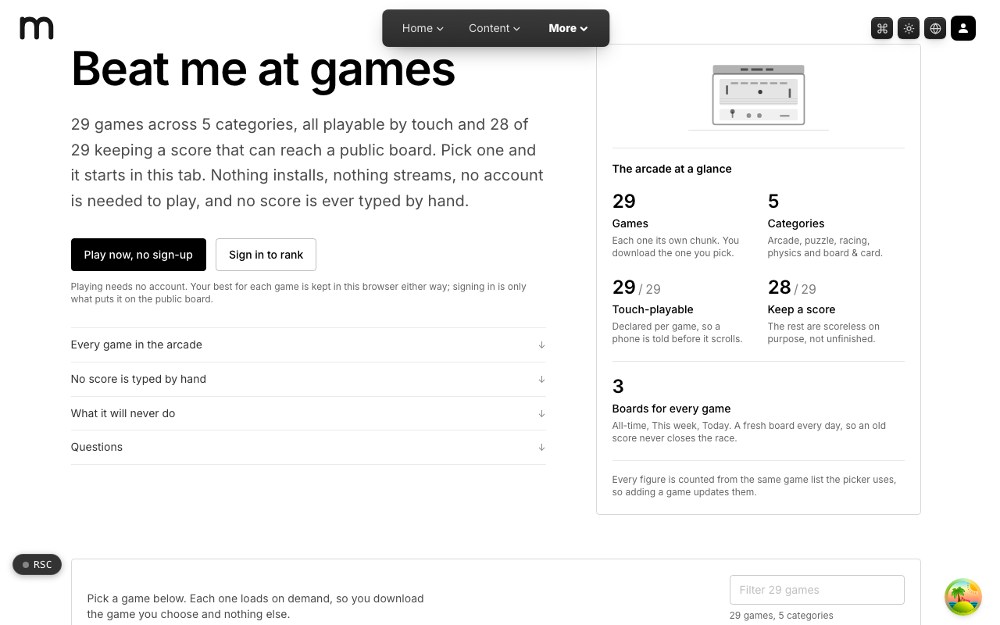

  <picture>
    <source media="(prefers-color-scheme: dark)" srcset=".github/assets/hero-dark.png">
    
  </picture>

# beat.me.at

Beat me at games: a free solo browser arcade of bespoke React and canvas games with a public leaderboard.

beat.me.at is a single-player arcade. Pick a game and it starts in the same tab: nothing installs, nothing streams, and no account is needed to play. Signing in is only what puts a score on the public board, and no score is ever typed by hand.

## Features

- **29 games, 5 categories**: arcade, puzzle, racing, physics, and board & card games behind one filterable picker, from Asteroids and Tetris to Sudoku, Pinball, and Solitaire.
- **Loaded on demand**: each game is its own chunk, so you download only the one you pick.
- **Touch-playable**: every game declares touch support, so a phone is told before it scrolls.
- **Three boards per game**: All-time, This week, and Today, so an old score never closes the race.
- **Scores come from play**: games report their own scores; signed-out players still keep a local personal best in the browser.
- **Fair leaderboards**: server-side session gating, a per-account write budget, and plausibility checks that flag (never rank) implausible scores.
- **Shareable scores**: every score has a public share page with its own social preview image.
- **Card tables against AI**: Online Poker and Online UNO pit you against AI seats, with level progression after you clear the bar.

## Built with

- Next.js 16 (App Router), React 19, TypeScript
- Tailwind CSS 4
- Canvas-based game components
- oRPC + TanStack Query for the leaderboard API
- Drizzle ORM + Postgres
- Better Auth (shared `*.me.at` account)

## Part of the me.at family

beat.me.at is one of my [`*.me.at`](https://me.at) apps. They share one design system, account, and app shell. Development happens in a private monorepo; this repository is the project's public-facing home.

## License

See [LICENSE](LICENSE).
