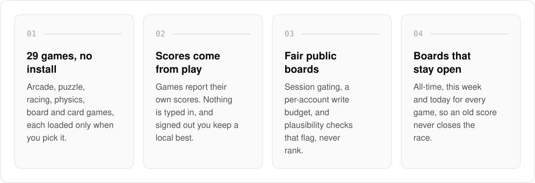
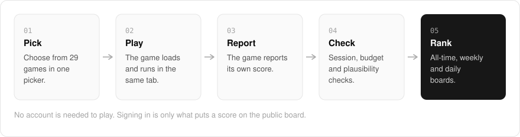

  <picture>
    <source media="(prefers-color-scheme: dark)" srcset=".github/assets/hero-dark.png">
    
  </picture>

<h1 align="center">beat.me.at</h1>

<strong>Beat me at games: a free solo browser arcade of bespoke React and canvas games with a public leaderboard.</strong>

  
  
  

  <a href="https://beat.me.at">Website</a> ·
  <a href="#features">Features</a> ·
  <a href="#how-it-works">How it works</a> ·
  <a href="#built-with">Built with</a>

A quick game in the browser should not need an install, and a high-score board should not believe whatever number it is sent. I built beat.me.at as a free single-player arcade: pick one of 29 games and it starts in the same tab, with nothing to install or stream and no account needed to play. Signing in is only what puts a score on the public board, and every score comes from the game itself, never from a text box.

  <picture>
    <source media="(prefers-color-scheme: dark)" srcset=".github/assets/overview-dark.svg">
    
  </picture>

## Why beat.me.at

| The usual high-score board | beat.me.at |
| --- | --- |
| Accepts whatever number is submitted | Scores come only from the game itself |
| Outliers go straight to the top | Implausible scores are flagged, never ranked |
| One all-time board nobody can catch | All-time, this week and today for every game |
| A big download before you play | Each game is its own chunk, loaded when you pick it |

## Features

- **29 games, 5 categories**: arcade, puzzle, racing, physics, and board and card games behind one filterable picker, from Asteroids and Tetris to Sudoku, Pinball, and Solitaire.
- **Loaded on demand**: each game is its own chunk, so you download only the one you pick.
- **Touch-playable**: every game declares touch support, so a phone is told before it scrolls.
- **Three boards per game**: All-time, This week, and Today, so an old score never closes the race.
- **Scores come from play**: games report their own scores; signed-out players still keep a local personal best in the browser.
- **Fair leaderboards**: server-side session gating, a per-account write budget, and plausibility checks that flag (never rank) implausible scores.
- **Shareable scores**: every score has a public share page with its own social preview image.
- **Card tables against AI**: Online Poker and Online UNO pit you against AI seats, with level progression after you clear the bar.

## How it works

  <picture>
    <source media="(prefers-color-scheme: dark)" srcset=".github/assets/flow-dark.svg">
    
  </picture>

Each game is its own chunk, so picking one downloads only that game. When a run ends, the game reports its own score: signed-out players keep a local personal best, and signed-in scores pass server-side session gating, a per-account write budget and plausibility checks before they rank on the all-time, weekly and daily boards. Implausible scores are flagged, never ranked.

## Built with

  
  
  
  
  

- Next.js 16 (App Router), React 19, TypeScript
- Tailwind CSS 4
- Canvas-based game components
- oRPC + TanStack Query for the leaderboard API
- Drizzle ORM + Postgres
- Better Auth (shared `*.me.at` account)

## Part of the me.at family

beat.me.at is one of my [`*.me.at`](https://me.at) apps. They share one design system, account, and app shell. Development happens in a private monorepo; this repository is the project's public-facing home.

## License

Source-available. See [LICENSE](LICENSE).
